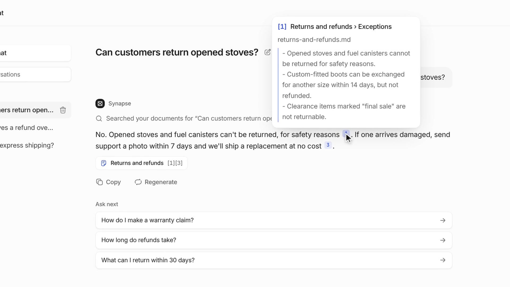

# Synapse

**Answers from your own documents, with the sources to prove them.** Synapse is an open-source,
self-hosted knowledge assistant for teams: add your policies, guides and playbooks, ask in plain
words, and every claim in the answer links to the passage it came from.



Dual-licensed **MIT OR Apache-2.0**: free for any team or company to use, change and run.

## What it does

- **Bring your knowledge.** Upload text, Markdown and PDF (several at once), paste text, or add a
  web page by its address. Documents are split into passages that keep their headings.
- **Ask, and check.** Streaming chat and a Playground answer from your documents only, with
  numbered citations, source cards, follow-up suggestions and regenerate with kept versions.
- **See how answers are made.** Each answer records its passages, model, prompt version and cost.
  The retrieval inspector compares meaning, keyword and hybrid search side by side.
- **Measure quality.** Write the questions your team asks and score how often each search mode
  finds the right documents, optionally grading the answers too.
- **Built for teams.** Organizations and roles, restricted documents, email invitations, single
  sign-on (OpenID Connect), two-step sign-in, personal API keys, approvals before risky actions,
  and an append-only activity log with personal data redacted.
- **Operable.** Usage and cost by model and prompt, system health with circuit breakers, background
  jobs that resume after a restart, OpenTelemetry / Langfuse tracing, backups.
- **Any model.** OpenRouter or any OpenAI-compatible endpoint, OpenAI, Anthropic, Google; optional
  Cohere reranking.

## Try it locally

You need [Bun](https://bun.sh) `1.4.4`, Docker (for Postgres with pgvector) and an API key for a
model provider ([OpenRouter](https://openrouter.ai) by default).

```bash
git clone https://github.com/shabirkhan-dev/synapse.git
cd synapse
bun install
cp .env.example .env          # then set AI_API_KEY (and AI_EMBEDDING_API_KEY if embeddings use another key)
docker compose up -d postgres
bun run db:migrate
bun run dev
```

Open http://localhost:3000 and create an account. In development no email service is needed:
verification and invitation links are printed in the API's log. New workspaces offer three sample
documents to try questions on straight away.

| App | URL |
| --- | --- |
| Console | http://localhost:3000 |
| API | http://localhost:8000 (`/api/v1/health`, docs at `/api/docs`) |

## Run it for your team

[`deploy/`](deploy/README.md) runs the whole stack on one server with Docker Compose: automatic
HTTPS (Caddy), API, worker, console, Postgres and daily backups (optionally copied off-site).
Production refuses development secrets, so set your own `JWT_SECRET`, `AUTH_ENCRYPTION_KEY`
(`openssl rand -base64 32`), a model key and a [Resend](https://resend.com) key for emails.
Runbooks for deploys, backups and incidents are in [docs/runbooks/](docs/runbooks/README.md).

## Contributing

Issues and pull requests are welcome: see [CONTRIBUTING.md](CONTRIBUTING.md). Report security
problems privately as described in [SECURITY.md](SECURITY.md).

## Layout

### Apps

| Path | What it is |
| --- | --- |
| `apps/api` | Bun + Hono API — RAG on pgvector, streaming tool-calling chat (AI SDK) |
| `apps/worker` | Background jobs on pg-boss: re-embedding after a model change, daily pruning |
| `apps/console` | Next.js 16 console: documents, chat, playground, retrieval, evaluations, team, oversight |

### Packages

| Package | Path | Role |
| --- | --- | --- |
| `@synapse/core` | `packages/core` | Errors, config loading, shared types, contracts |
| `@synapse/adapters` | `packages/adapters` | Model gateway (AI SDK, OpenAI-compatible) |
| `@synapse/ingestion` | `packages/ingestion` | Normalization, content-hash dedup, ingestion pipeline |
| `@synapse/knowledge` | `packages/knowledge` | Chunking, embedding preparation, chunk versions |
| `@synapse/retrieval` | `packages/retrieval` | Vector, keyword and hybrid (RRF) retrieval |
| `@synapse/generation` | `packages/generation` | Versioned prompts, budgeted context, citations, provenance |
| `@synapse/observability` | `packages/observability` | Structured logs, OpenTelemetry tracing, LLM usage/cost |
| `@synapse/evaluation` | `packages/evaluation` | Retrieval datasets, recall@k / MRR, CI regression baselines |
| `@synapse/audit` | `packages/audit` | Append-only event history; every answer with its provenance |
| `@synapse/guardrails` | `packages/guardrails` | Input policy, prompt-injection defense, tool allowlist, output checks |
| `@synapse/human-oversight` | `packages/human-oversight` | Approval requests, review queue, decisions, answer feedback |
| `@synapse/memory` | `packages/memory` | Conversation history within a budget; long-term facts recalled by meaning |
| `@synapse/orchestration` | `packages/orchestration` | LangGraph graphs with Postgres checkpoints (RAG answer with citation retry) |
| `@synapse/security` | `packages/security` | Authentication (passwords, tokens, TOTP, OIDC checks), roles, PII redaction |
| `@synapse/reliability` | `packages/reliability` | Timeouts, retries, circuit breakers, fallback models |
| `@synapse/providers` | `packages/providers` | Model vendors: OpenAI, Anthropic, Google, Cohere, OpenAI-compatible |
| `@synapse/native` | `packages/native` | Rust token counting (napi-rs) with a TypeScript fallback |
| `@synapse/database` | `packages/database` | Drizzle client, schema, migrations (Postgres + pgvector) |
| `@synapse/ui` | `packages/ui` | shadcn/ui on Base UI (style `base-mira`), HugeIcons, Tailwind v4 |
| `@synapse/typescript-config` | `packages/typescript-config` | Base tsconfigs every workspace extends |

### Everything else

| Path | Purpose |
| --- | --- |
| `.agents/` | Agent rules, skills, memory, roles and the coordination board |
| `AGENTS.md`, `CLAUDE.md`, `opencode.json` | Agent entry points (see `docs/agents/tool-compatibility.md`) |
| `docs/` | Architecture, packages, ADRs, development, API, runbooks, guides |
| `docker/` | Compose fragments: Postgres (pgvector), API, console |
| `scripts/` | Bash utilities, plus architecture and naming checks |
| `.github/workflows/` | `ci.yml`, `cd.yml`, `security.yml` |
| `.devcontainer/` | Bun + Rust + Bash tooling |
| `crates/` | Rust libraries and the napi-rs binding |
| `deploy/` | Production compose, Caddy, backups |
| `tests/` | Browser end-to-end (Playwright, axe) and system suites (security, chaos, load) |

## Commands

| Command | Does |
| --- | --- |
| `bun run dev` / `dev:api` / `dev:console` | All dev servers / one app |
| `bun run build` | Build every app |
| `bun run db:generate` / `db:migrate` | Generate / apply database migrations |
| `bun run eval:retrieval` | Retrieval eval vs baseline (needs `DATABASE_URL`) |
| `bun run lint` / `lint:fix` | oxlint, plus ShellCheck over `scripts/` |
| `bun run format` | Format TS/JS and shell |
| `bun run typecheck` | TypeScript across workspaces |
| `bun run test` / `test:coverage` | Unit tests / coverage gates |
| `bun run architecture:check` | Import-boundary rules |
| `bun run naming:check` | File and symbol naming rules |
| `bun run preflight` | `lint` + `typecheck` + `test` — run before pushing |

## Tooling

- **Bun** workspaces and **Turborepo** for the task graph
- **oxlint** for linting and **oxfmt** for formatting TS/JS — tabs, line width 100
- **Lefthook** pre-commit and commit-msg, enforcing Conventional Commits
- Bash: ShellCheck + shfmt

## Docker

`docker compose up -d --build` builds and runs Postgres, API, worker and console in production mode
(set the secrets listed under "Run it for your team" first). Console `:3000`, API `:8000`, Postgres
on host `:5433`. More in [docker/README.md](docker/README.md). Maintainers pull `.env` from
Doppler with `bun run env:pull` ([docs/development/secrets.md](docs/development/secrets.md)).

## Dev Container

`.devcontainer/` installs **Bun**, **Rust** and the Bash lint tools.

```text
Reopen in Container → bun run prepare → bun run dev
```

See [.devcontainer/README.md](.devcontainer/README.md).

## Docs

Start at [docs/README.md](docs/README.md). Also: [PROJECT.md](PROJECT.md), [AGENTS.md](AGENTS.md),
[apps/api/README.md](apps/api/README.md), [apps/worker/README.md](apps/worker/README.md), [packages/ui/README.md](packages/ui/README.md).

## License

Dual-licensed under **MIT** or **Apache-2.0**, at your option —
[LICENSE-MIT](LICENSE-MIT), [LICENSE-Apache-2.0](LICENSE-Apache-2.0).
